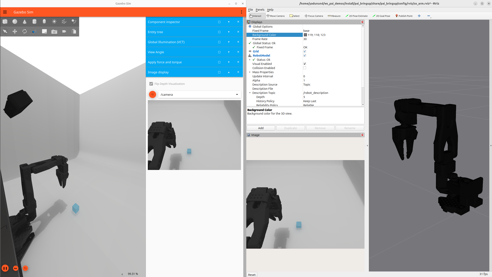
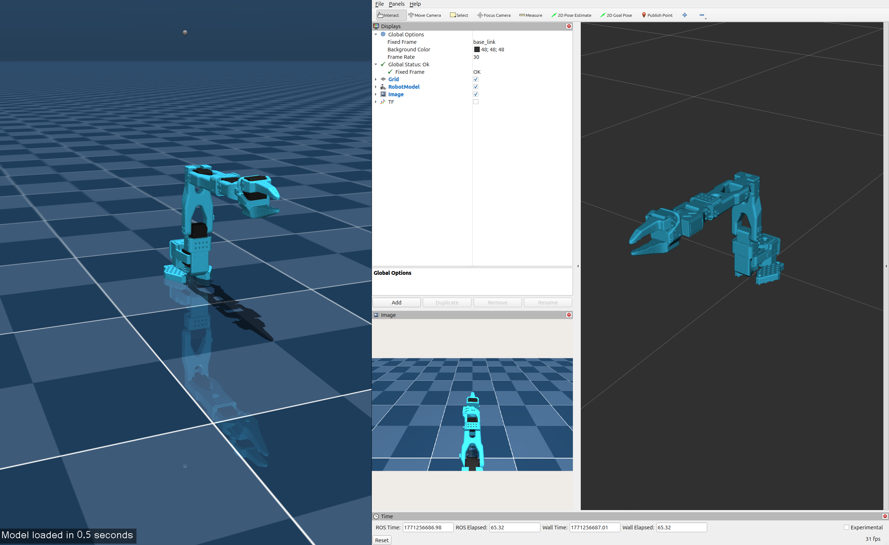

# Running the Robot

This guide covers launching the SO-ARM101 in simulation (Gazebo or MuJoCo) or on real hardware.

> [!IMPORTANT]
> This project uses `rmw_zenoh` as the ROS 2 middleware. The Zenoh router must be
> running before launching any demo. Start it in a dedicated terminal and leave it
> running for the duration of your session:
>
> ```bash
> pixi run zenoh-router
> ```
>
> Then open a second terminal for the launch commands below. When using a manual
> (non-Pixi) install, see [Installation](installation.md#middleware-rmw_zenoh).

## Gazebo



```bash
ros2 launch pai_bringup so_arm_gz_bringup.launch.py
```

With Pixi:

```bash
pixi run so-arm-gz
```

## MuJoCo



```bash
ros2 launch pai_bringup so_arm_mujoco_bringup.launch.py
```

With Pixi:

```bash
pixi run so-arm-mujoco
```

## Real hardware

```bash
ros2 launch pai_bringup so_arm_real_bringup.launch.py usb_port:=/dev/so101_follower
```

With Pixi:

```bash
pixi run so-arm-real usb_port:=/dev/so101_follower
```

Before running on real hardware, complete the one-time hardware setup in this order:

1. [Udev rules](hardware/udev-rules.md) — `dialout` permissions and the `/dev/so101_follower` and `/dev/so101_leader` symlinks that the later steps use.
2. [Servo calibration](hardware/calibration.md) — calibrate each arm so encoder zero aligns with the expected physical pose.
3. [Cameras](hardware/cameras.md) — wrist/static camera configuration and overrides.

## Leader arm teleoperation

You can use a leader SO-ARM101 to teleoperate the follower arm (sim or real):

```bash
ros2 launch pai_leader_teleop leader_bringup.launch.py usb_port:=/dev/so101_leader
```

With Pixi:

```bash
pixi run so-arm-leader usb_port:=/dev/so101_leader
```

See the [Teleoperation Overview](teleoperation.md) for all available teleoperation methods.

## MCP interface

You can connect the robot to an AI agent to control, introspect, or debug it via MCP, in simulation
or on real hardware. See [MCP Interface](mcp.md).
